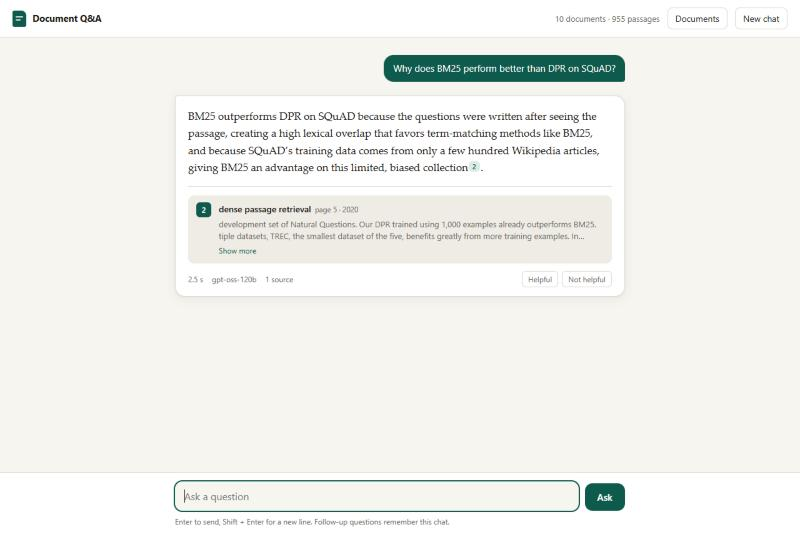
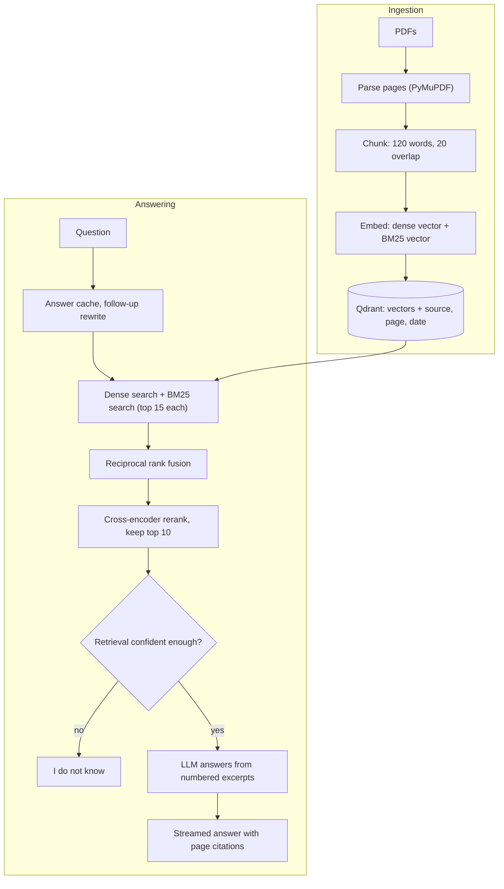

# Document Q&A Assistant (RAG) with Evaluation

[](https://github.com/imyashguptaa/rag/actions/workflows/ci.yml)

A retrieval-augmented generation (RAG) service that answers questions about a folder of PDFs.
Every answer cites the page it came from, and the assistant says "I do not know" when the
documents do not cover the question.

The project is built around measurement: a 100-question evaluation set with verified source
pages, a baseline, and one change at a time with the result recorded.



## Results

Retrieval, measured on 100 questions (10 per paper, each with a verified gold page):

| Step | Change | recall@5 | recall@1 | Retrieval time |
|---|---|---|---|---|
| Baseline | Dense search, 220-word chunks | 0.69 | 0.38 | 7 ms |
| 1 | 120-word chunks | 0.76 | 0.45 | 7 ms |
| 2 | + BM25 hybrid search (reciprocal rank fusion) | 0.84 | 0.57 | 40 ms |
| 3 | + cross-encoder reranker, 30 candidates | 0.89 | 0.68 | 1,104 ms |
| 4 | Reranker on 15 candidates | 0.89 | 0.67 | 479 ms |
| 5 | + document title on each embedded chunk | 0.89 | 0.68 | 480 ms |

Step 5 raised recall@10 from 0.94 to 0.97, and ten chunks are passed to the answer model.

| Measure | Result |
|---|---|
| Answer correctness, baseline (100 questions) | 53 of 100 |
| Answer correctness, improved pipeline (same 100 questions) | 87 of 100 |
| Faithfulness: answers fully supported by the excerpts they cite | 92 of 99 answered |
| Out-of-scope questions refused | 8 of 10 before the LLM is called; the prompt handles the rest |
| Answerable questions wrongly refused | 0 of 100 |
| Prompt-injection tests passing | 10 of 10 |

Things that were tried and rejected (larger chunks, a query instruction prefix, three other
rerankers) are recorded with their numbers in [docs/DECISIONS.md](docs/DECISIONS.md).

**Read the numbers with these limits in mind.** The baseline and the improved pipeline were
answered by different models (`gpt-oss-120b` and `qwen3.8-27b`) because of the free API quota,
so part of the 53 → 87 gain may come from the model and not from retrieval. Correctness and
faithfulness are graded by an LLM judge, which is not perfect. The questions were written by
the same person who built the system and are mostly single-fact questions in clean English.
See [Status](#status).

## How it works



- **Ingestion.** PDFs are parsed page by page, split into 120-word chunks with a 20-word
  overlap, and stored in Qdrant with a dense embedding, a BM25 sparse vector, and the source
  file, page and date. A chunk never crosses a page, so every citation has an exact page.
- **Retrieval.** Dense search finds chunks with the same meaning; BM25 finds chunks with the
  same exact words. The two lists are merged by reciprocal rank fusion and re-sorted by a
  cross-encoder.
- **Refusal.** If the best match is below a calibrated similarity threshold, the assistant
  refuses without calling the LLM. The prompt also requires a refusal when the excerpts do not
  contain the answer.
- **Generation.** The model answers only from numbered excerpts and cites them as `[1]`, `[2]`.
  The server maps each number back to a file and page, so the model cannot invent a source.
- **Incremental updates.** A registry of file hashes lets one document be added, replaced or
  deleted without rebuilding the index.

## Features

- Hybrid retrieval (dense + BM25) with reranking
- Cited answers and an "I do not know" path
- Chat memory that summarises old turns past a token limit, and rewrites follow-up questions
- Streaming API (server-sent events) and a chat web page
- Easy questions routed to a smaller model, with fallback when a model is rate-limited
- Answer cache that is invalidated whenever the index changes
- Document upload with validation and background indexing
- Per-caller rate limit, request ids, structured JSON request logs, feedback endpoint
- Prompt-injection defences with 10 tests
- CI: lint, dependency audit, tests, and a gate that fails the build if recall@5 drops below 0.85

## Tech stack

| Area | Choice |
|---|---|
| Language | Python |
| API | FastAPI, server-sent events |
| Vector database | Qdrant (dense + sparse vectors) |
| Embeddings | `BAAI/bge-small-en-v1.5` through fastembed (ONNX, runs on CPU) |
| Keyword search | BM25 as a Qdrant sparse vector |
| Reranker | `ms-marco-MiniLM-L-6-v2` cross-encoder |
| LLMs | Groq: `gpt-oss-120b` (answers), `gpt-oss-20b` (easy questions, rewriting, judging) |
| PDF parsing | PyMuPDF |
| App state | SQLite |
| Packaging and CI | Docker, docker-compose, GitHub Actions |

No LangChain or LlamaIndex: the application is about 1,100 lines of plain Python, so every
step can be read, tested and measured. The reason for each choice, and what was rejected, is
in [docs/DECISIONS.md](docs/DECISIONS.md).

## Quick start

Requires Python 3.10 or newer and a [Groq API key](https://console.groq.com/).

```bash
python -m venv .venv
.venv/Scripts/python -m pip install -r requirements.txt -r requirements-dev.txt   # Linux/macOS: .venv/bin/python
cp .env.example .env                                      # then put your GROQ_API_KEY in it
.venv/Scripts/python scripts/download_corpus.py           # ten public arXiv papers into data/pdfs
.venv/Scripts/python -m docqa.ingest                      # parse, chunk, embed, store
.venv/Scripts/python -m uvicorn docqa.api:app --port 8000
```

Open `http://localhost:8000/` for the chat page, or `http://localhost:8000/docs` for the
interactive API docs.

To use your own documents, copy PDFs into `data/pdfs` and run the ingest command again, or
upload them from the Documents panel on the chat page. Only new, changed or removed files are
processed.

With Docker (starts the API and a Qdrant server):

```bash
docker compose up --build
```

## API

| Request | What it does |
|---|---|
| `POST /ask` `{"question": "...", "session_id": "abc", "stream": true}` | Answer. Streams server-sent events (`token`, then `done` with sources and timings). `session_id` turns on chat memory. `"stream": false` returns one JSON object |
| `POST /feedback` `{"request_id": "...", "rating": "up"}` | Rate an answer. The request id comes back with every answer |
| `GET /documents` | List indexed documents |
| `POST /documents` (multipart `file`) | Add a PDF, or replace the indexed version of the same name. Rejects files with no text. Returns a job id; indexing runs in the background |
| `GET /documents/jobs/{id}` | Progress of one upload: queued, processing, done or failed |
| `DELETE /documents/{name}` | Remove one document |
| `GET /metrics` | Latency p5 / p50 / p95, cache hit rate, token totals and feedback counts |
| `GET /health` | Status and index size |

## Evaluation and tests

```bash
.venv/Scripts/python -m pytest -q                                   # unit tests + 10 prompt-injection tests
.venv/Scripts/python -m eval.run_eval --label my_run                # recall@5 on 100 questions (free, local)
.venv/Scripts/python -m eval.run_eval --label my_run --answers      # also answer correctness (uses Groq)
.venv/Scripts/python -m eval.run_eval --mode dense --chunk-words 220 --chunk-overlap 40   # the baseline
.venv/Scripts/python -m scripts.latency_bench                       # p5 / p50 / p95 before and after caching + routing
.venv/Scripts/python -m ruff check .                                # lint
.venv/Scripts/python -m pip_audit -r requirements.txt               # known vulnerabilities in dependencies
```

- `eval/questions.jsonl`: 100 questions, each with its source document, gold page(s) and a
  reference answer.
- `eval/unanswerable.jsonl`: 10 out-of-scope questions for the refusal test.
- `eval/results/`: the raw output of every run quoted above.

## Project layout

```
docqa/
  config.py      every setting, overridable by environment variable
  ingest.py      parse, chunk, embed, store; incremental add / update / delete
  index.py       embedding models and the Qdrant collection
  retrieve.py    dense, hybrid and reranked retrieval
  prompts.py     every prompt and the context formatter
  answer.py      the pipeline: cache, refusal, model routing, generation, citations
  memory.py      chat history with summarisation
  llm.py         Groq client with model fallback
  store.py       SQLite: document registry, sessions, request log, feedback
  api.py         FastAPI app
  static/        the chat web page
eval/            evaluation set, runner and recorded results
tests/           unit tests and prompt-injection tests
scripts/         corpus download and latency benchmark
docs/            DECISIONS.md: how it works, why, and every measurement
```

## Status

Done and measured: ingestion, hybrid retrieval with reranking, citations, refusal, chat
memory, the API and chat page, incremental updates, prompt-injection tests, and CI.

Not done yet:

- **Deployment.** `render.yaml` and the Dockerfile are ready, but the service is not live.
- **Latency target.** The benchmark for cutting p95 with caching and model routing
  (`scripts/latency_bench.py`) has not completed a run. Retrieval takes about 480 ms, almost
  all of it the reranker.
- **Same-model comparison.** The baseline and improved answer runs used different answer
  models. Rerunning the improved pipeline on the baseline's model needs more than one day of
  the free quota.
- **Languages.** The embedding model is English-only; Hinglish queries are untested.

## Deploy on Render

1. In the repository settings, add `GROQ_API_KEY` under Secrets and variables > Actions, so CI can run the injection tests and the answer evaluation.
2. In the Render dashboard choose New > Blueprint and pick the repository. Render reads `render.yaml` and asks for `GROQ_API_KEY`.
3. After the first deploy, copy the generated `API_KEY` from the service's Environment page. Send it as the `X-API-Key` header on every request except `/health` and the chat page.

`render.yaml` defaults to the free plan without the reranker. Its header comment explains the paid alternative that runs the full pipeline.
